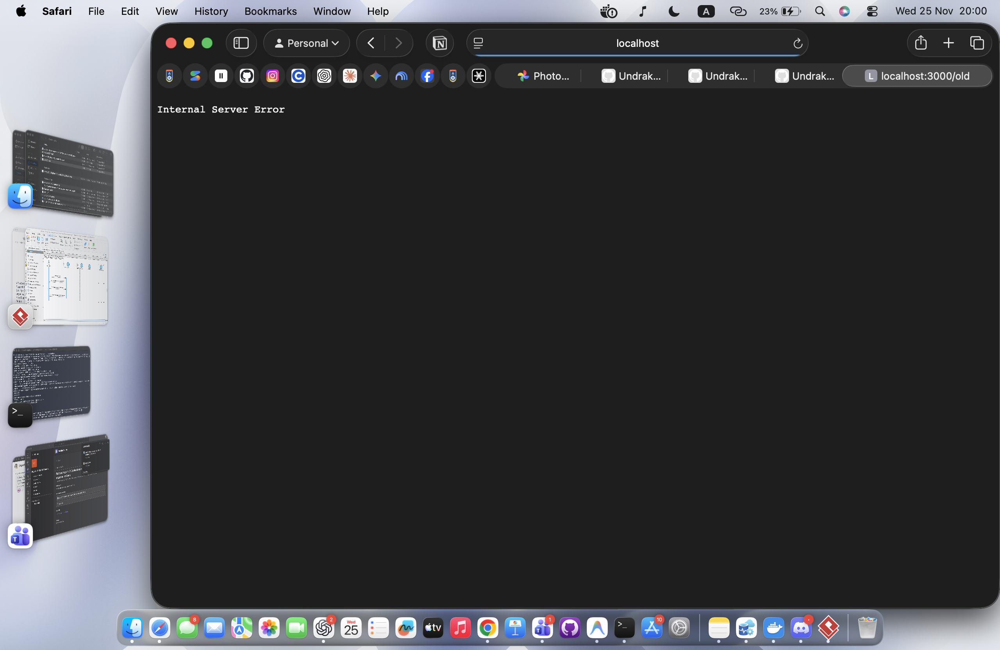

# BUG-01: Хүснэгтэд номын «Он» энгийн тоогоор биш мянгатын таслалтай харагдаж байна

Орчин:  Уншлагын жагсаалт v2.0, Safari, macOS, 2026-11-25
Урьдчилсан нөхцөл: node app.js-ийг шинээр асаасан (анхны 3 ном)

## Дахин гаргах алхам
1. Терминал дээр `node app.js` коммандаар серверийг асаана.
2. Браузер дээр `http://localhost:3000` хаягийг нээнэ.
3. Номын жагсаалтын хүснэгтийн «Он» баганын утгуудыг харна.

Хүлээгдэж байсан: Спецификацийн 2-р дүрмийн дагуу он нь 1000-2100 хоорондох бүхэл тоо бөгөөд хүснэгтэд энгийн тоогоор (жишээ нь `1999`, `1971`, `2008`) харагдана.
Бодит үр дүн:     Хүснэгтийн «Он» баганад онууд `1,971`, `2,008`, `1,999` гэж мянгатын таслалтай форматлагдаж харагдаж байна.

Ноцтой байдал: Minor — Өгөгдөл хадгалагдах болон нэмэгдэх ажиллагаанд саад учруулахгүй ч спецификацийн форматын шаардлагыг зөрчиж буй харагдах байдлын алдаа.
Хавсралт:      
Олдсон аялал:  Fed-Ex Tour (Business District)
