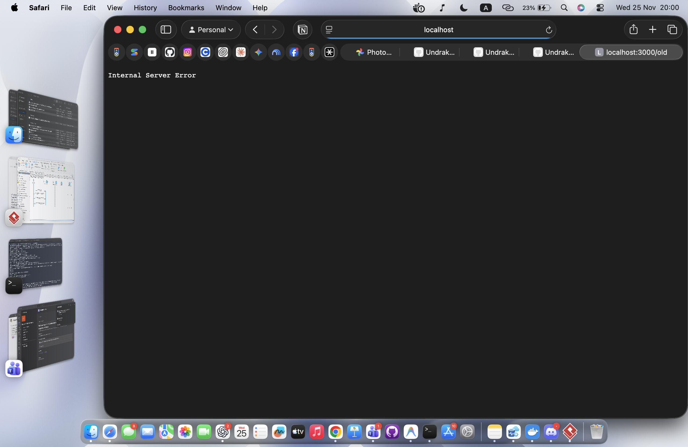

# BUG-02: Аюултай үйлдлийн «Устгах» товч улаан биш ногоон өнгөтэй байна

Орчин:  Уншлагын жагсаалт v2.0, Safari, macOS, 2026-11-25
Урьдчилсан нөхцөл: node app.js-ийг шинээр асаасан (анхны 3 ном)

## Дахин гаргах алхам
1. Терминал дээр `node app.js` коммандаар серверийг асаана.
2. Браузер дээр `http://localhost:3000` хаягийг нээнэ.
3. Жагсаалтын мөр бүрийн баруун талд байрлах «Устгах» товчны өнгийг ажиглана.

Хүлээгдэж байсан: Спецификацийн 6-р дүрмийн дагуу аюултай үйлдлийн товч («Устгах») улаан өнгөтэй байна.
Бодит үр дүн:     «Устгах» товч нь улаан биш тод ногоон (`#2e7d32` орчим) өнгөтэй харагдаж байгаа нь хэрэглэгчид эерэг/аюулгүй үйлдэл мэт төөрөгдөл төрүүлнэ.

Ноцтой байдал: Minor — Хэрэглэгчийн интерфейсийн өнгөний дохиолол буруу тул санамсаргүй өгөгдөл устгах эрсдэлтэй.
Хавсралт:      
Олдсон аялал:  Fed-Ex Tour (Business District)
