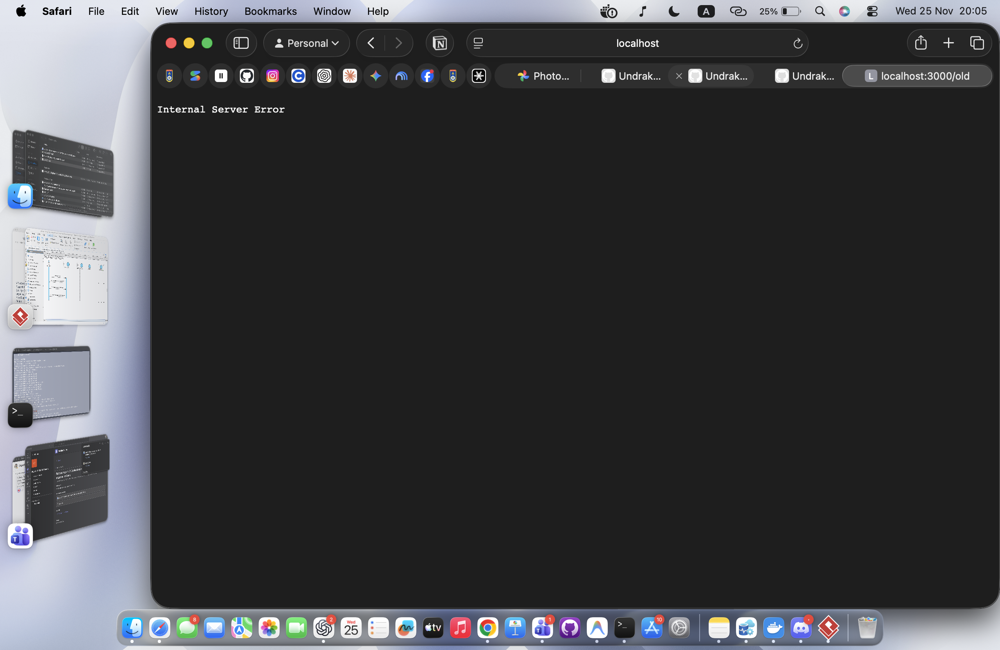

# BUG-03: «Хуучин хувилбар» линк дээр дарахад Internal Server Error (500) гарч байна

Орчин:  Уншлагын жагсаалт v2.0, Safari, macOS, 2026-11-25
Урьдчилсан нөхцөл: node app.js-ийг шинээр асаасан

## Дахин гаргах алхам
1. Терминал дээр `node app.js` коммандаар серверийг асаана.
2. Браузер дээр `http://localhost:3000` хаягийг нээнэ.
3. Хуудасны доод хэсэгт байрлах «Хуучин хувилбар» линк (`/old` гэх мэт) дээр дарна.

Хүлээгдэж байсан: Спецификацийн 8-р дүрмийн дагуу бүх хуудас, линк алдаагүй ажиллана (эсвэл хуучин хувилбарын хуудас нээгдэнэ).
Бодит үр дүн:     Хуудсанд «Internal Server Error» гэсэн алдаа гарч ажиллахгүй байна.

Ноцтой байдал: Major — Хэрэглэгчид харагдах линк дээр дарахад сервер дотоод алдаа (500) зааж эвдэрч байна.
Хавсралт:      
Олдсон аялал:  Antisocial Tour (Seedy District)
