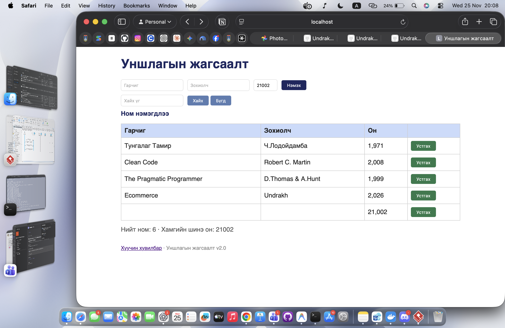

# BUG-05: «Нийт ном» тоолуур хүснэгтэд буй бодит номын тооноос 1-ээр илүү гарч байна

Орчин:  Уншлагын жагсаалт v2.0, Safari, macOS, 2026-11-25
Урьдчилсан нөхцөл: node app.js-ийг шинээр асаасан (анхны 3 ном)

## Дахин гаргах алхам
1. Терминал дээр `node app.js` коммандаар серверийг асаана.
2. Браузер дээр `http://localhost:3000` хаягийг нээж анхны 3 ном байгааг шалгана.
3. Шинэ номууд нэмж хүснэгтэд нийт 5 мөр ном үүсгэнэ.
4. Хүснэгтэд харагдаж буй бодит мөрийн тоо болон хүснэгтийн доорх «Нийт ном» тоолуурыг харьцуулна.

Хүлээгдэж байсан: Спецификацийн 7-р дүрмийн дагуу «Нийт ном» тоолуур хүснэгтэд буй номын тоотой тэнцүү (`5`) байна.
Бодит үр дүн:     Хүснэгтэд 5 мөр ном байгаа боловч доор нь «Нийт ном: 6» гэж 1-ээр зөрүүтэй (off-by-one) тоолж харуулж байна.

Ноцтой байдал: Major — Хэрэглэгчид харагдах үндсэн тооцоолол, статистик мэдээлэл буруу гарч байгаа тул өгөгдлийн найдвартай байдалд сөргөөр нөлөөлнө.
Хавсралт:      
Олдсон аялал:  Fed-Ex Tour (Business District)
