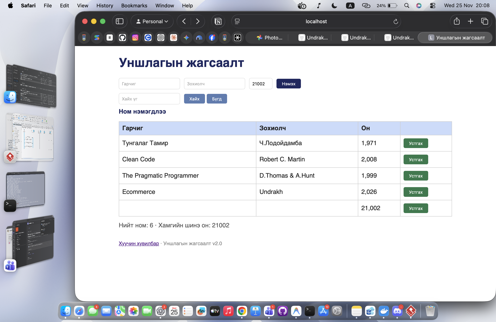

# BUG-06: Хоосон талбар болон 1000–2100 хязгаараас хэтэрсэн он оруулахад ном нэмэгдэж байна

Орчин:  Уншлагын жагсаалт v2.0, Safari, macOS, 2026-11-25
Урьдчилсан нөхцөл: node app.js-ийг шинээр асаасан (анхны 3 ном)

## Дахин гаргах алхам
1. Терминал дээр `node app.js` коммандаар серверийг асаана.
2. Браузер дээр `http://localhost:3000` хаягийг нээнэ.
3. Гарчиг болон Зохиолч талбарыг хоосон орхиж, Он талбарт `21002` гэж оруулаад «Нэмэх» товч дарна.
4. Хүснэгтэд шинэ мөр нэмэгдсэн эсэх болон алдааны мессеж гарсан эсэхийг шалгана.

Хүлээгдэж байсан: Спецификацийн 1 ба 2-р дүрмийн дагуу Гарчиг, Зохиолч, Он бүгд бөглөгдсөн бөгөөд Он нь 1000–2100 хоорондох бүхэл тоо байх ёстой; зөрчсөн тохиолдолд ном нэмэгдэхгүй, ойлгомжтой алдааны мессеж харагдана.
Бодит үр дүн:     Алдааны мессеж гаралгүй, хоосон гарчиг/зохиолчтой бөгөөд `21,002` гэсэн хүчингүй онтой мөр хүснэгтэд шууд нэмэгдэж байна.

Ноцтой байдал: Major — Оролтын баталгаажуулалт (input validation) огт ажиллахгүй байгаа тул өгөгдлийн санд эвдэрхий, хоосон бичлэгүүд үүсэж байна.
Хавсралт:      
Олдсон аялал:  Antisocial Tour (Seedy District)
